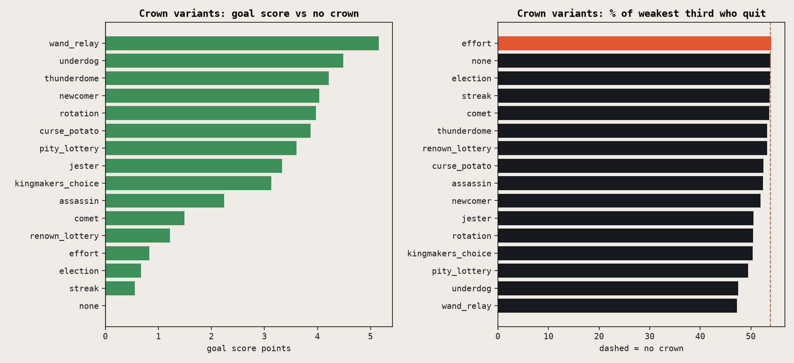
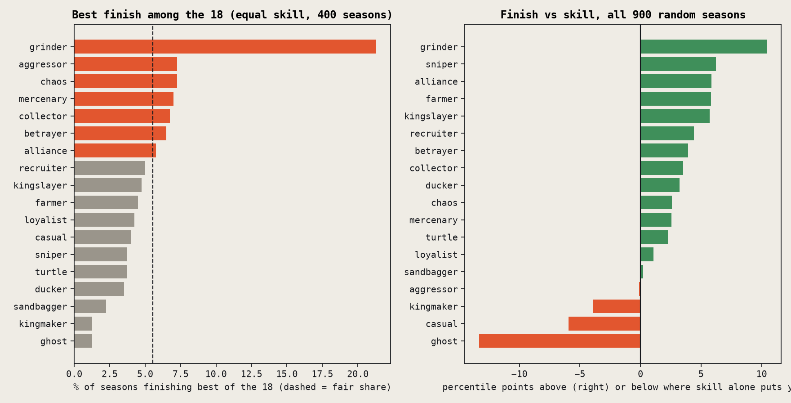
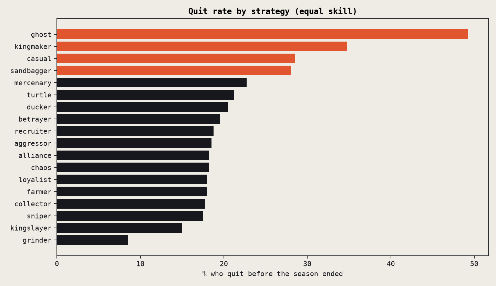
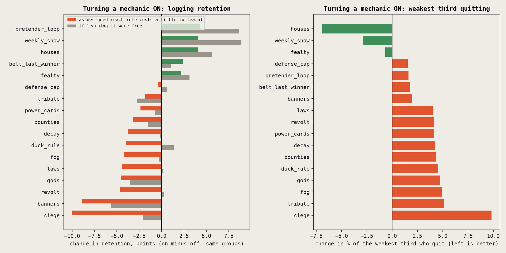
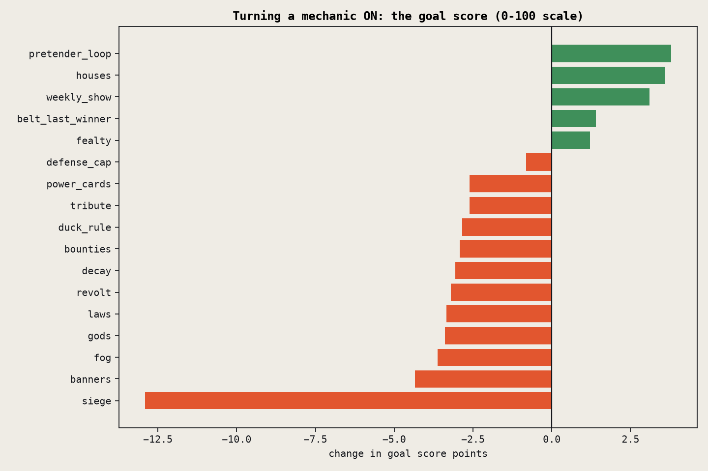
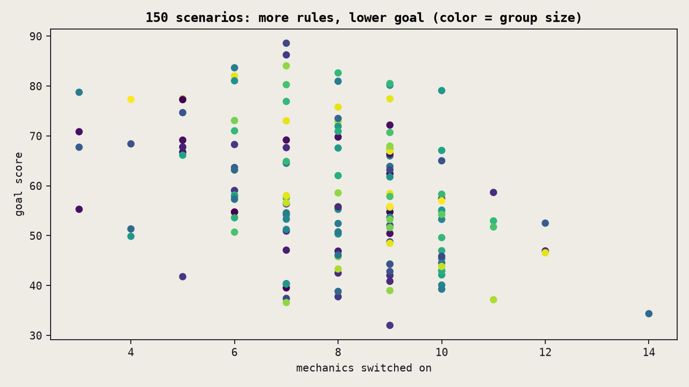
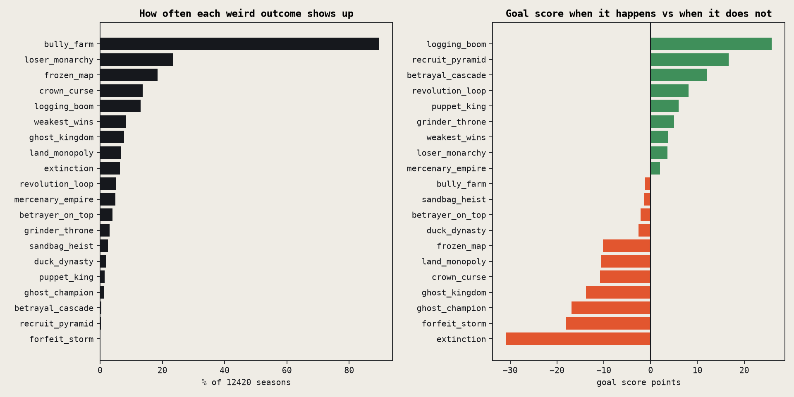
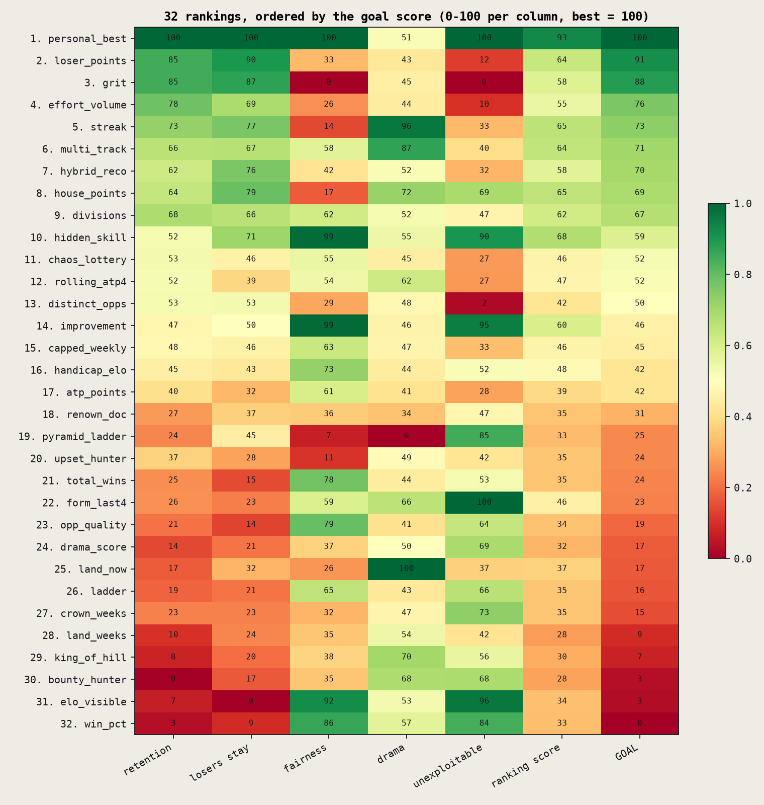
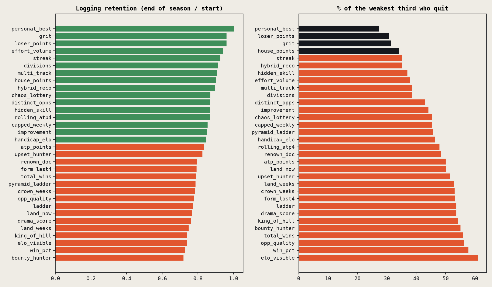

# LobsOfLove: next steps, rotating crowns, and a season simulator

October 20, 2026, revised the same day after a code review by Codex. Code: `sim.py` (the model), `report.py` (charts and tables), `confirm_test.py` (one follow-up test). Rebuild everything with `./run.sh` in this folder. About 55,000 simulated seasons in total; the full run takes a few minutes.

**Read this first.** The simulator is a model with constants I made up and then calibrated so a plain friend group (no feudal mechanics, the app's current points table) behaves like the problem we already know: about 40% of the weakest third quit at some point in a season, and logging volume sags about 13%. It is good for comparing mechanics against each other under the same assumptions. It is not a forecast. Every verdict below was also rerun with each of the model's load-bearing assumptions switched off, and it says which ones survive.

Every result is judged against one goal score (0 to 100): logging that lasts through the season (45%), the weakest third still playing (25%), new people pulled in and kept (15%), a story worth telling (10%), and a table that roughly matches skill (5%).

## What changed after the review

Codex found nine real bugs and two assumptions that were doing too much work. All are fixed and everything was rerun.

- **Crowns read the wrong week.** The crown was picked after the weekly match counts reset, so "most matches" and "worst week" crowns were effectively random, and holders looked idle every week. Fixed. The crown standings changed.
- **A knight who won a defense was replaced by their lord** for everything after the match (crown hand-offs, banners, motivation). Fixed.
- **Siege didn't block the last-winner rule**, and its gate counted repeat wins over anyone. Now a closed gate blocks every transfer, and opening it takes beating two different regulars. Siege got much worse.
- **Decay could strip a holder who played that week**, betrayals moved land after holdings were tallied, mercenaries could still claim land and never got banners back, divisions sorted on last week's scores, and multi-track broke ties by list order. All fixed.
- **A loss now hurts whether or not anyone logs it**, because you still lost on court. Previously only confirmed losses stung, which made easier confirming look worse than it is.
- **"Quit" now means quit at any point**, even if they came back. Before, it meant inactive at the end, which let mechanics with comeback bonuses look better. The weekly show's assumed comeback boost was also halved, and comebacks can no longer happen in the same week someone quits.
- **The strategy duel compares the 18 contestants with each other.** Before, recruits and extra players could take first place too, so the fair-share line was wrong.

What that reversed: the last-winner belt rule fell from the second-best mechanic to a small positive (+7.8 to +1.4), its "never freezes the map" result turned out to be siege's doing, and "scheming never pays" is now "no scheme clearly beats fair share."

---

## Part 1: Next steps, ruthless and in order

Where the code is today: a shared season on Supabase (anonymous accounts, crews, invite and claim links, pretenders), scores that count only when the loser confirms, a belt per court held by whoever won the last confirmed match there, the crew team photo with circle-to-call-up, and leave, delete and remove. None of it has been on a friend's phone yet.

| # | Step | Why it is next | Effort | Unblocks |
|---|---|---|---|---|
| 1 | **Get it onto friends' phones.** Renew the Apple developer account, make an EAS development build and TestFlight, and serve invite links from lobsoflove.app as universal links. | Invite links only work on your home network in Expo Go today. Nothing below can be tested until two phones share a season. | 1 to 2 days plus Apple's wait | Everything |
| 2 | **A push to the loser with a one-tap confirm, and a push when you are called up.** | In the model about a third of matches people play never get confirmed. Making logging and confirming easier lifts logged matches by 25% (0.71 to 0.89 per player per week) and halves the unconfirmed share (34% to 16%). It costs the weakest third about 2.5 points of quitting, because more losses become public, so ship it with step 3. | 2 to 3 days (expo-notifications, a database trigger or edge function) | Real logging volume |
| 3 | **Change what the table shows.** Replace the points table on home and standings: each player's own screen shows personal best (progress against their own past), and the public table pays for every match, win or lose (loser points: 60 a win, 50 a loss). | The app's current table (ATP-style points) is 17th of 32 on the goal (58.1), with half the weakest third quitting. Personal best scores 70.7 with 27% quitting; loser points 68.8 with 31%. | 1 day (rankings are computed in `src/lib/matches.ts`) | Losers who keep playing |
| 4 | **Close the pretender loop.** A call-up or challenge sent to a pretender texts them their claim link. | The most robust mechanic in the model: +3.8 goal, +7.4 new people kept per 100 players, and positive under every assumption test. The pieces already exist. | 1 day | Growth past one friend group |
| 5 | **The weekly show, version 1.** A Sunday recap card for the group chat: belt changes, upsets, call-ups that happened, and one line about someone near the bottom who played. | +3.1 goal and weakest-third quitting down 2.9 points. It only works if being in the story keeps people playing, which is exactly what the test in step 6 checks. | 2 to 3 days | Retention of the bottom half |
| 6 | **Run the two-week friend test.** Instrument confirmed matches per week, unconfirmed share, call-ups answered, who stops, and whether people who appear in the recap play more the next week. | It measures the three assumptions the verdicts lean on: what a rule costs to learn, how often losers confirm, and whether the story motivates. | 2 weeks on the calendar, half a day of instrumentation | Calibrating every verdict below |
| 7 | **Make the land visible, and add the wand.** Show each court's holder standing on it on the courts screen. Add one wand per crew that passes to the opponent after every confirmed match its holder plays. | The game has to show up somewhere. The belt rule itself is only a small plus in the model (+1.4), but it is already the code's rule and costs nothing to keep. The wand is the best crown (+5.2 over no crown) and stays in the top three under every assumption test. | 3 days | A reason to play this week |
| 8 | **Houses, once a crew passes about ten people.** | +3.6 goal and weakest-third quitting down 6.9 points, the best number for the bottom of any mechanic, and positive under every assumption test. Pointless with three friends. | 3 days | Scale |
| - | Housekeeping before friends invest time | Anonymous accounts vanish with a reinstall: link Sign in with Apple before the test grows. Regenerate database types (`db/sync-types.sh`). | 1 day | Not losing people's seasons |

**Do not build:** siege, banners, laws, the duck rule (all negative under every assumption tested), and gods, tribute, bounties, revolt, decay, fog and power cards (negative at the default cost of learning a rule). Decay does stop people who quit from holding courts (1.8% of seasons against 11.9%), but at a cost of 3.1 on the goal.

---

## Part 2: The rotating crown, 15 variants

A crown is power that changes hands on a schedule or a trigger, not only by beating someone. In the simulator, whoever holds it gets a small lift in motivation and plays a little more, and the crew plays about 3% more while someone holds it. The variants differ only in who gets it and when. Crowns are picked from the previous week's results.

| Variant | How it moves | Weird because |
|---|---|---|
| rotation | Everyone gets a week, in order | Pure fairness, zero agency |
| curse_potato | The crown is bad: its holder plays at a disadvantage and loses it by playing anyone | People play to get rid of something |
| wand_relay | After every confirmed match its holder plays, it passes to the opponent, win or lose | Power spreads through the people who play the most |
| underdog | Goes to whoever had the worst week | Losing earns the crown |
| renown_lottery | Weekly draw weighted by renown | The rich get luckier |
| pity_lottery | Weekly draw weighted toward the bottom | Charity with a scepter |
| effort | Most confirmed matches last week | Rewards logging directly |
| assassin | Beat the king and it is yours; a king idle for a week drops it | A moving target |
| election | Everyone votes; knights vote for lords, houses for leaders | Politics, coalitions |
| kingmakers_choice | The king picks the next king | Dynasties and favors |
| comet | A random court each week; the first confirmed match there wins it | Pilgrimage on a deadline |
| streak | Longest unbroken run of weeks with a logged match | Consistency as royalty |
| newcomer | The newest member wears it | A welcome gift |
| jester | The lowest on the table gets a veto | The fool rules |
| thunderdome | Two random players are drawn each week; the winner of their match takes it | Forced rivalries |

| crown | goal | vs no crown | logging retention | bottom third quit | drama | crown time to weakest third | to strongest third | most crowned strategy |
|---|---|---|---|---|---|---|---|---|
| wand_relay | 56.0 | +5.2 | 0.805 | 47% | 0.46 | 32% | 40% | casual (19%) |
| underdog | 55.3 | +4.5 | 0.799 | 48% | 0.39 | 46% | 23% | casual (18%) |
| thunderdome | 55.1 | +4.2 | 0.807 | 53% | 0.45 | 20% | 52% | casual (19%) |
| newcomer | 54.9 | +4.0 | 0.779 | 52% | 0.38 | 39% | 31% | casual (34%) |
| rotation | 54.8 | +4.0 | 0.784 | 50% | 0.40 | 29% | 40% | casual (21%) |
| curse_potato | 54.7 | +3.9 | 0.772 | 53% | 0.49 | 30% | 42% | casual (19%) |
| pity_lottery | 54.5 | +3.6 | 0.763 | 49% | 0.39 | 36% | 33% | casual (25%) |
| jester | 54.2 | +3.3 | 0.760 | 51% | 0.38 | 40% | 32% | casual (31%) |
| kingmakers_choice | 54.0 | +3.1 | 0.782 | 50% | 0.39 | 43% | 27% | casual (17%) |
| assassin | 53.1 | +2.2 | 0.761 | 52% | 0.43 | 12% | 67% | casual (19%) |
| comet | 52.3 | +1.5 | 0.750 | 54% | 0.37 | 15% | 58% | casual (19%) |
| renown_lottery | 52.1 | +1.2 | 0.738 | 53% | 0.37 | 24% | 48% | casual (20%) |
| effort | 51.7 | +0.8 | 0.737 | 54% | 0.36 | 20% | 55% | grinder (16%) |
| election | 51.5 | +0.7 | 0.742 | 54% | 0.36 | 23% | 46% | alliance (36%) |
| streak | 51.4 | +0.6 | 0.729 | 54% | 0.37 | 26% | 47% | casual (18%) |
| none | 50.8 | +0.0 | 0.720 | 54% | 0.31 | - | - | - |

**The wand relay wins** (+5.2 over no crown). It and the jester are the only crowns in the top three under every assumption test, including the one where crowns no longer make anyone play more, and the wand ranks first in three of the five. It moves power along the people who play, and it hands the weakest third 32% of crown time. **Underdog** (+4.5) is second and gives the weakest third 46% of crown time, the most of any crown. **Thunderdome** (+4.2) is third. At the bottom: **streak** (+0.6), **election** (+0.7, alliance builders hog 36% of crown time), **effort** (+0.8) and **comet** (+1.5). Crowns that reward what the good players already do (most matches, longest streak, votes, beating the king) barely beat having no crown. Crowns that move fast or go to the bottom do best.

---

## Part 3: The simulator

**Players.** 6 to 30 per crew, each with hidden skill, how often they play, loyalty, tilt (how hard losses hit), competitiveness, and a love of tennis that motivation drifts back toward. Motivation rises with playing, winning, holding land, being in a storyline and belonging to a lord or house. It falls with every loss (logged or not), losing land, sitting in the bottom quarter of a visible table, being beaten by the same person over and over, going two weeks without a game, and every extra rule to keep track of. Two weeks below the line and they quit; a few come back.

**A match only counts if it is logged and confirmed.** The winner logs it, more often with something at stake. The loser confirms it, less often after losing a belt or getting farmed, more often when the ranking pays something for losing.

**18 strategies, all fighting over the same courts and crown:** casual, loyalist, ghost (rarely plays), grinder (plays a lot), aggressor (challenges the strongest holder), turtle (avoids defending), ducker (dodges stronger players), betrayer (swears fealty and then takes half the lord's land), kingmaker (throws matches to prop up a weak friend), recruiter (brings people in), mercenary (hunts bounties), sandbagger (loses early to sink the table), chaos agent, alliance builder, sniper (only takes good odds), farmer (beats the weakest over and over), kingslayer (only targets the king), and collector (explores and claims courts).

**Mechanics, each on or off:** laws, fealty, bounties, banners, revolt, decay, gods, defense cap, duck rule, tribute, power cards, siege, houses, fog, pretender loop, weekly show, and the belt rule (last winner holds it, or you must beat the holder).

| Experiment | Seasons |
|---|---|
| 150 random scenarios (size, length, mechanics, crown, ranking, parameters all drawn at random), 6 seeds each | 900 |
| Every ranking on the same 60 scenarios, 4 seeds | 7,680 |
| Mechanic ablation: 60 groups, each mechanic flipped off and on with everything else equal, with and without the cost of learning it | 16,320 |
| Every crown on the same 60 groups, 4 seeds | 3,840 |
| Assumption tests: mechanics, crowns and rankings rerun with each load-bearing assumption switched off | 24,600 |
| Strategy head-to-head: one of each strategy at the same skill, dropped into 400 random groups | 400 |
| Rule-cost grid, and an easier-confirm test | 720 + 960 |

### Strategy win rates

| strategy | best of the 18 (fair share 5.6%) | avg finish (1=top) | land share | crown share | quit rate | matches logged | lift over skill (all games) | win rate |
|---|---|---|---|---|---|---|---|---|
| grinder | 21.2% | 0.74 | 8.4% | 7.0% | 8% | 25.9 | +10.4 pts | 51% |
| aggressor | 7.2% | 0.58 | 5.0% | 4.0% | 18% | 15.1 | -0.1 pts | 48% |
| chaos | 7.2% | 0.56 | 5.3% | 3.0% | 18% | 14.5 | +2.6 pts | 50% |
| mercenary | 7.0% | 0.57 | 6.4% | 4.2% | 23% | 14.9 | +2.6 pts | 50% |
| collector | 6.8% | 0.53 | 6.7% | 3.6% | 18% | 15.4 | +3.5 pts | 48% |
| betrayer | 6.5% | 0.57 | 5.6% | 3.5% | 20% | 14.5 | +3.9 pts | 51% |
| alliance | 5.8% | 0.56 | 4.9% | 6.7% | 18% | 15.4 | +5.9 pts | 52% |
| recruiter | 5.0% | 0.55 | 4.1% | 3.7% | 19% | 14.2 | +4.4 pts | 51% |
| kingslayer | 4.8% | 0.58 | 5.0% | 6.5% | 15% | 15.5 | +5.7 pts | 51% |
| farmer | 4.5% | 0.51 | 4.0% | 3.3% | 18% | 13.2 | +5.8 pts | 57% |
| loyalist | 4.2% | 0.54 | 4.1% | 4.5% | 18% | 16.3 | +1.1 pts | 44% |
| casual | 4.0% | 0.54 | 4.4% | 5.2% | 28% | 12.1 | -5.9 pts | 51% |
| sniper | 3.8% | 0.57 | 5.9% | 3.5% | 18% | 15.1 | +6.2 pts | 52% |
| turtle | 3.8% | 0.53 | 3.2% | 3.1% | 21% | 12.2 | +2.3 pts | 53% |
| ducker | 3.5% | 0.52 | 3.1% | 3.2% | 20% | 11.7 | +3.2 pts | 54% |
| sandbagger | 2.2% | 0.48 | 3.0% | 3.3% | 28% | 12.6 | +0.2 pts | 48% |
| kingmaker | 1.2% | 0.44 | 3.4% | 3.4% | 35% | 11.0 | -3.9 pts | 45% |
| ghost | 1.2% | 0.39 | 1.9% | 3.0% | 49% | 5.2 | -13.3 pts | 51% |

Each of the 400 head-to-head seasons has exactly one of each strategy at the same skill, so a fair share of "best of the 18" is 5.6%. **The grinder takes 21.2%**, 3.8 times its share, and quits least (8%). **No scheming strategy clearly beats fair share.** Mercenary (7.0%), betrayer (6.5%), aggressor and chaos (7.2%) sit slightly above it, but with 400 seasons the margin of error is about 1.2 points, so they are within noise. Sandbaggers (2.2%) and duckers (3.5%) do worse than fair share. The kingmaker finishes best only 1.2% of the time, but its goal is to lift a friend, which this table does not measure. The farmer wins 57% of its matches, the most of anyone, and still finishes best only 4.5% of the time. The model does not include fake scores or two players colluding on confirms, so it says nothing about those kinds of cheating.

### Mechanic impact

| mechanic | goal score | logging retention | bottom third quit | new people kept | drama | goal if learning it were free | retention if free | hurts in % of groups |
|---|---|---|---|---|---|---|---|---|
| pretender_loop | +3.8 | +4.3 | +1.6 pts | +7.4 per 100 | +0.01 | +8.1 | +8.6 | 25% |
| houses | +3.6 | +4.0 | -6.9 pts | +0.8 per 100 | +0.01 | +3.2 | +5.7 | 38% |
| weekly_show | +3.1 | +4.0 | -2.9 pts | +1.6 per 100 | +0.04 | +6.0 | +8.9 | 40% |
| belt_last_winner | +1.4 | +2.4 | +1.8 pts | +0.1 per 100 | +0.09 | +1.7 | +1.0 | 40% |
| fealty | +1.2 | +2.2 | -0.7 pts | +0.6 per 100 | +0.02 | +0.9 | +3.1 | 45% |
| defense_cap | -0.8 | -0.4 | +1.5 pts | -0.4 per 100 | -0.00 | +0.6 | +0.6 | 50% |
| power_cards | -2.6 | -2.4 | +4.2 pts | -0.9 per 100 | -0.00 | +0.3 | -0.7 | 60% |
| tribute | -2.6 | -1.8 | +5.1 pts | -1.3 per 100 | -0.02 | -1.0 | -2.7 | 67% |
| duck_rule | -2.8 | -4.0 | +4.6 pts | -1.3 per 100 | +0.01 | +0.9 | +1.4 | 75% |
| bounties | -2.9 | -3.2 | +4.3 pts | -1.9 per 100 | +0.01 | -0.6 | -1.5 | 65% |
| decay | -3.1 | -3.8 | +4.3 pts | -1.2 per 100 | -0.01 | +0.1 | -0.2 | 63% |
| revolt | -3.2 | -4.6 | +4.1 pts | -0.9 per 100 | -0.01 | +0.2 | +0.3 | 73% |
| laws | -3.3 | -4.4 | +4.0 pts | -1.1 per 100 | -0.02 | -0.5 | +0.2 | 67% |
| gods | -3.4 | -4.5 | +4.7 pts | -1.1 per 100 | -0.03 | -1.2 | -3.5 | 65% |
| fog | -3.6 | -4.2 | +4.9 pts | -1.6 per 100 | -0.01 | -0.6 | -0.3 | 68% |
| banners | -4.3 | -8.9 | +2.0 pts | -0.8 per 100 | -0.02 | -1.1 | -5.6 | 78% |
| siege | -12.9 | -10.0 | +9.8 pts | -2.6 per 100 | -0.34 | -8.0 | -2.1 | 93% |

Five mechanics help at the default cost of learning a rule: **the pretender loop** (+3.8 goal, +7.4 new people kept per 100), **houses** (+3.6 goal, weakest-third quitting down 6.9 points), **the weekly show** (+3.1), **the last-winner belt rule** (+1.4) and **fealty** (+1.2). Twelve hurt. The grey bars show each one as if learning it were free: most of the harm is the cost of one more thing to remember and one more step to log. Siege, laws and banners stay negative even when free. Tribute, bounties, gods and fog land between -1.2 and +1.5 when free, depending on the sample, so call them a wash at best.

**Which verdicts survive the assumption tests.** Each row reruns the mechanic flips (on the same 30 groups) with one assumption switched off. The crown row matches the first row because these groups have no crown.

| assumption | weekly_show | belt_last_winner | pretender_loop | houses | fealty | laws | duck_rule | banners | gods | tribute | siege |
|---|---|---|---|---|---|---|---|---|---|---|---|
| as built | +7.0 | +0.5 | +7.2 | +0.8 | -1.1 | -2.9 | -1.7 | -1.3 | -3.9 | -1.7 | -11.4 |
| rules cost nothing | +7.6 | +0.1 | +9.8 | +3.6 | +1.1 | -0.3 | -0.2 | -0.8 | +1.5 | +0.8 | -9.9 |
| no bottom-of-table sting | +3.5 | +2.2 | +4.0 | +1.5 | -2.6 | -3.8 | -1.2 | -1.5 | -6.6 | -5.4 | -14.4 |
| no story bonus | -1.9 | +1.9 | +4.0 | +2.3 | -1.5 | -3.2 | -1.7 | -5.7 | -5.0 | -4.4 | -7.3 |
| crowns do not change play | +7.0 | +0.5 | +7.2 | +0.8 | -1.1 | -2.9 | -1.7 | -1.3 | -3.9 | -1.7 | -11.4 |

- **Survive every test:** the pretender loop and houses stay positive in all five rows. Siege, laws, banners and the duck rule stay negative in all five.
- **Depend on one assumption:** the weekly show is +3.5 to +7.6, except when being in the story stops motivating anyone, where it is -1.9. Gods and tribute turn slightly positive if rules cost nothing to learn.
- **Small either way:** the last-winner belt rule is +0.1 to +2.2, and fealty swings between -2.6 and +1.1.

Your favorites, bluntly:
- **Siege** is the worst thing in the model: -12.9 goal, hurts in 93% of groups, and negative under every test. A closed gate freezes the map in 34% of seasons, against 0.2% without siege.
- **Banners:** logging retention -8.9 and negative under every test. Running out of banners blocks challenges above your weight, so people stop playing the matches they care about.
- **Laws:** -3.3 goal and negative under every test, even when free. The home-court edge protects holders, and protected holders stop the land from moving.
- **The duck rule** (accept within 7 days or the belt is stripped): -2.8 goal, hurts in 75% of groups. A forfeit replaces a match that would have been logged.
- **Fealty** and **the last-winner rule** are the doc's best ideas in the model, and both are small.

**How many rules:**

| mechanics switched on | seasons | logging retention | bottom third quit | goal |
|---|---|---|---|---|
| 3-5 | 96 | 0.938 | 29% | 66.3 |
| 6-8 | 408 | 0.878 | 44% | 60.2 |
| 9-11 | 372 | 0.801 | 53% | 55.0 |
| 12-14 | 24 | 0.675 | 68% | 45.1 |

**How sure is that?** The "fewer rules" verdict rests on the cost of a rule. With everything switched on:

| weekly cost per rule | logging friction per rule | retention: lean | retention: everything on | bottom quit: lean | bottom quit: everything on | goal: lean | goal: everything on |
|---|---|---|---|---|---|---|---|
| 0.0 | 0.0 | 0.863 | 1.124 | 35% | 17% | 61.1 | 78.0 |
| 0.0 | 0.012 | 0.863 | 1.110 | 35% | 21% | 61.1 | 71.6 |
| 0.0 | 0.024 | 0.863 | 1.169 | 35% | 31% | 61.1 | 64.9 |
| 0.004 | 0.0 | 0.863 | 0.507 | 35% | 76% | 61.1 | 36.1 |
| 0.004 | 0.012 | 0.863 | 0.468 | 35% | 76% | 61.1 | 31.3 |
| 0.004 | 0.024 | 0.863 | 0.336 | 35% | 85% | 61.1 | 21.7 |
| 0.008 | 0.0 | 0.863 | 0.217 | 35% | 98% | 61.1 | 15.1 |
| 0.008 | 0.012 | 0.863 | 0.197 | 35% | 98% | 61.1 | 13.1 |
| 0.008 | 0.024 | 0.863 | 0.117 | 35% | 98% | 61.1 | 9.0 |

If rules cost nothing to learn, turning everything on beats a lean setup (78.0 against 61.1). At the default cost (0.004 motivation a week per rule) it collapses to 31.3, and at double that to 13.1. Nobody knows the real number yet. The two-week test should measure it by watching whether people who see more rules log less.

### Group size

| group size | seasons | logging retention | bottom third quit | new people kept per 100 | drama | goal |
|---|---|---|---|---|---|---|
| 6-11 | 240 | 0.825 | 46% | 10.7 | 0.44 | 56.9 |
| 12-17 | 204 | 0.844 | 50% | 9.2 | 0.37 | 56.3 |
| 18-23 | 234 | 0.871 | 45% | 11.5 | 0.44 | 60.9 |
| 24-29 | 192 | 0.843 | 46% | 9.5 | 0.42 | 58.8 |
| 30-35 | 30 | 0.887 | 46% | 14.6 | 0.21 | 59.5 |

Size barely matters between 6 and 30. The mechanics and the ranking matter more.

### The weirdest outcomes

| outcome | how often | seasons | goal when it happens | retention | bottom third quit | verdict |
|---|---|---|---|---|---|---|
| extinction | 6.4% | 800 | -30.9 | -39.6 | +42.8 pts | HURTS |
| forfeit_storm | 0.0% | 3 | -18.0 | -26.6 | +18.9 pts | too rare to call (3 seasons) |
| ghost_champion | 1.4% | 170 | -16.9 | -22.4 | +21.7 pts | HURTS |
| ghost_kingdom | 7.8% | 963 | -13.8 | -16.0 | +20.1 pts | HURTS |
| crown_curse | 13.7% | 1705 | -10.8 | -13.7 | +17.7 pts | HURTS |
| land_monopoly | 6.7% | 834 | -10.6 | -12.9 | +13.0 pts | HURTS |
| frozen_map | 18.5% | 2295 | -10.2 | -9.3 | +8.5 pts | HURTS |
| duck_dynasty | 2.0% | 248 | -2.6 | +1.3 | +2.3 pts | HURTS |
| betrayer_on_top | 3.9% | 489 | -2.1 | -0.7 | +2.2 pts | HURTS |
| sandbag_heist | 2.5% | 311 | -1.5 | +0.5 | +3.0 pts | neutral |
| bully_farm | 89.5% | 11111 | -1.2 | -5.3 | +7.9 pts | neutral |
| mercenary_empire | 4.9% | 605 | +2.0 | +0.9 | -1.0 pts | HELPS |
| loser_monarchy | 23.3% | 2899 | +3.6 | +3.3 | -8.8 pts | HELPS |
| weakest_wins | 8.4% | 1044 | +3.8 | +5.2 | -14.7 pts | HELPS |
| grinder_throne | 3.1% | 383 | +5.0 | +7.7 | -7.1 pts | HELPS |
| puppet_king | 1.5% | 190 | +6.0 | +8.1 | -18.4 pts | HELPS |
| revolution_loop | 5.0% | 623 | +8.1 | +7.2 | -7.0 pts | HELPS |
| betrayal_cascade | 0.3% | 42 | +12.0 | +8.8 | -16.3 pts | too rare to call (42 seasons) |
| recruit_pyramid | 0.2% | 27 | +16.7 | +25.7 | +3.8 pts | too rare to call (27 seasons) |
| logging_boom | 13.1% | 1624 | +25.9 | +64.0 | -15.7 pts | HELPS |

The weird ones, judged against the goal. These compare seasons where something happened with seasons where it didn't, so they show what goes with what, not what causes what.

- **Extinction** (6.4% of seasons): over half the crew gone by the end. Goal -30.9. These seasons had more mechanics on (9.4 against 7.9).
- **Frozen map** (18.5%): nobody takes a court in the second half of the season. Goal -10.2. It is almost all siege: 34% of seasons with siege, 0.2% without. With siege off, the belt rule makes no difference (0% against 0.6%).
- **Ghost kingdom** (7.8%): someone who quit still holds a court. Goal -13.8. Decay fixes it (1.8% against 11.9%). The last-winner rule also helps when decay is off (2.3% against 7.5%), without an extra rule to learn.
- **Crown curse** (13.7%): the crown holder quits while holding it. Goal -10.8. A symptom: the crown landed on someone already leaving. A crown on an inactive player should move on.
- **Land monopoly** (6.7%): one player holds over 60% of all land over the season. Goal -10.6.
- **Loser monarchy** (23.3%): the crown spends most of the season with someone from the weakest third. Goal +3.6, weakest-third quitting down 8.8 points. Underdog crowns do it 54% of the time, kingmaker's choice 46%, assassin 11%. It helps.
- **Weakest wins** (8.4%): someone from the weakest third finishes #1. Goal +3.8, weakest-third quitting down 14.7 points. A table the worst player can top keeps the rest of the bottom around.
- **Revolution loop** (5.0%): revolts keep happening. Goal +8.1. When revolts happen they help, but the revolt mechanic still loses overall (-3.2) because of what it costs to learn.
- **Puppet king** (1.5%): a kingmaker's weak friend ends up #1. Goal +6.0. Funny, harmless and rare.
- **Grinder throne** (3.1%): the #1 has a losing record. Goal +5.0. It looks absurd and it is fine: the person playing the most is on top.
- **Bully farm** (89.5% of seasons have someone who lost four times to the same person): retention -5.3 and weakest-third quitting +7.9 in those seasons. Worth a "you two again?" nudge toward someone new.
- **Logging boom** (13.1%): logging ends the season well above where it started. Goal +25.9, but that is close to circular: a logging boom is what a good season looks like, not a cause of one.

**The best and worst of the 150 scenarios:**

|  | goal | retention | bottom quit | scenario |
|---|---|---|---|---|
| best | 88.6 | 1.216 | 17% | n=11, 16 wk, crown=streak, ranking=loser_points, on: fealty, revolt, gods, duck_rule, houses, pretender_loop, weekly_show, belt_last_winner |
| best | 86.3 | 1.354 | 0% | n=10, 8 wk, crown=pity_lottery, ranking=drama_score, on: bounties, gods, defense_cap, duck_rule, houses, fog, weekly_show, belt_last_winner |
| best | 84.1 | 1.219 | 44% | n=26, 16 wk, crown=curse_potato, ranking=opp_quality, on: laws, revolt, decay, power_cards, houses, pretender_loop, weekly_show, belt_last_winner |
| best | 83.7 | 1.127 | 10% | n=16, 12 wk, crown=newcomer, ranking=land_now, on: laws, fealty, duck_rule, tribute, houses, pretender_loop, belt_last_winner |
| best | 82.6 | 1.146 | 36% | n=22, 16 wk, crown=wand_relay, ranking=house_points, on: laws, fealty, banners, gods, duck_rule, power_cards, pretender_loop, weekly_show, belt_last_winner |
| worst | 37.4 | 0.524 | 56% | n=11, 12 wk, crown=election, ranking=crown_weeks, on: fealty, banners, decay, defense_cap, tribute, siege, pretender_loop |
| worst | 37.2 | 0.536 | 85% | n=27, 16 wk, crown=election, ranking=land_now, on: laws, fealty, banners, revolt, decay, gods, duck_rule, tribute, power_cards, houses, pretender_loop, belt_last_winner |
| worst | 36.6 | 0.490 | 79% | n=26, 16 wk, crown=wand_relay, ranking=crown_weeks, on: fealty, gods, defense_cap, tribute, siege, fog, pretender_loop, belt_last_winner |
| worst | 34.4 | 0.547 | 88% | n=14, 16 wk, crown=kingmakers_choice, ranking=pyramid_ladder, on: laws, fealty, banners, revolt, decay, gods, defense_cap, duck_rule, tribute, power_cards, siege, houses, fog, weekly_show |
| worst | 32.0 | 0.431 | 72% | n=10, 16 wk, crown=underdog, ranking=land_now, on: laws, fealty, revolt, decay, gods, duck_rule, tribute, siege, pretender_loop, belt_last_winner |

All five of the best scenarios use the last-winner belt rule, and four of the five have houses. Four of the five worst have siege on.

---

## Part 4: Rankings

32 ways to rank a crew, each run on the same 60 scenarios. Each ranking also changes behavior: a win-percentage table makes careful players play less, a volume table makes them play more, and a table that pays for losses makes losers confirm more often.

The table is ordered by the goal score, the same score used everywhere else in this report. A second "ranking score" weighs things differently (35% logging retention, 25% weakest third staying, 15% drama, 15% hard to exploit, 10% fairness) and is shown for reference. "Exploit" is how far the best-performing strategy finishes above where its skill alone would put it, in percentile points.

| # | ranking | goal score | ranking score | logging retention | bottom third quit | fairness (rank vs skill) | drama index | exploit: best strategy lift | who breaks it |
|---|---|---|---|---|---|---|---|---|---|
| 1 | personal_best | 70.7 | 93 | 1.004 | 27% | +0.73 | 0.51 | +5.8 pts | farmer |
| 2 | loser_points | 68.8 | 64 | 0.960 | 31% | +0.31 | 0.45 | +19.3 pts | grinder |
| 3 | grit | 68.2 | 58 | 0.961 | 32% | +0.10 | 0.47 | +21.2 pts | grinder |
| 4 | effort_volume | 65.6 | 55 | 0.942 | 38% | +0.26 | 0.46 | +19.7 pts | grinder |
| 5 | streak | 64.9 | 65 | 0.926 | 35% | +0.19 | 0.85 | +16.2 pts | grinder |
| 6 | multi_track | 64.3 | 64 | 0.907 | 38% | +0.46 | 0.78 | +15.1 pts | grinder |
| 7 | hybrid_reco | 64.1 | 58 | 0.897 | 35% | +0.36 | 0.52 | +16.3 pts | grinder |
| 8 | house_points | 63.9 | 65 | 0.901 | 34% | +0.21 | 0.67 | +10.5 pts | grinder |
| 9 | divisions | 63.5 | 62 | 0.914 | 39% | +0.49 | 0.52 | +14.0 pts | grinder |
| 10 | hidden_skill | 61.8 | 68 | 0.868 | 37% | +0.72 | 0.54 | +7.2 pts | ghost |
| 11 | chaos_lottery | 60.3 | 46 | 0.870 | 45% | +0.45 | 0.47 | +17.0 pts | grinder |
| 12 | rolling_atp4 | 60.2 | 47 | 0.867 | 48% | +0.44 | 0.60 | +17.1 pts | grinder |
| 13 | distinct_opps | 59.9 | 42 | 0.869 | 43% | +0.28 | 0.49 | +20.9 pts | grinder |
| 14 | improvement | 59.0 | 60 | 0.853 | 44% | +0.72 | 0.48 | +6.5 pts | ghost |
| 15 | capped_weekly | 58.8 | 46 | 0.855 | 45% | +0.50 | 0.48 | +16.1 pts | grinder |
| 16 | handicap_elo | 58.1 | 48 | 0.847 | 46% | +0.56 | 0.46 | +13.3 pts | grinder |
| 17 | atp_points | 58.1 | 39 | 0.834 | 50% | +0.48 | 0.44 | +16.9 pts | grinder |
| 18 | renown_doc | 55.7 | 35 | 0.796 | 48% | +0.33 | 0.39 | +14.0 pts | grinder |
| 19 | pyramid_ladder | 54.4 | 33 | 0.786 | 46% | +0.15 | 0.14 | +8.1 pts | collector |
| 20 | upset_hunter | 54.3 | 35 | 0.825 | 51% | +0.17 | 0.50 | +14.8 pts | grinder |
| 21 | total_wins | 54.2 | 35 | 0.790 | 56% | +0.59 | 0.46 | +13.1 pts | grinder |
| 22 | form_last4 | 54.1 | 46 | 0.792 | 53% | +0.47 | 0.62 | +5.7 pts | farmer |
| 23 | opp_quality | 53.2 | 34 | 0.778 | 56% | +0.60 | 0.44 | +11.3 pts | grinder |
| 24 | drama_score | 52.8 | 32 | 0.759 | 54% | +0.34 | 0.50 | +10.6 pts | grinder |
| 25 | land_now | 52.7 | 37 | 0.768 | 50% | +0.27 | 0.88 | +15.5 pts | collector |
| 26 | ladder | 52.6 | 35 | 0.772 | 54% | +0.51 | 0.46 | +11.0 pts | collector |
| 27 | crown_weeks | 52.3 | 35 | 0.784 | 53% | +0.30 | 0.48 | +9.9 pts | farmer |
| 28 | land_weeks | 51.0 | 28 | 0.748 | 53% | +0.32 | 0.54 | +14.8 pts | collector |
| 29 | king_of_hill | 50.6 | 30 | 0.740 | 54% | +0.34 | 0.65 | +12.6 pts | collector |
| 30 | bounty_hunter | 49.8 | 28 | 0.718 | 55% | +0.32 | 0.64 | +10.6 pts | farmer |
| 31 | elo_visible | 49.7 | 34 | 0.737 | 61% | +0.68 | 0.53 | +6.3 pts | ghost |
| 32 | win_pct | 49.1 | 33 | 0.728 | 58% | +0.64 | 0.56 | +8.2 pts | farmer |

**Rankings under the assumption tests** (goal score, rerun on 30 scenarios):

| assumption | best 3 crowns (vs no crown) | worst crown | best 4 rankings by goal | personal_best / multi_track / renown_doc |
|---|---|---|---|---|
| as built | wand_relay +5.7, thunderdome +4.1, jester +3.3 | streak -3.9 | personal_best 69.0, grit 66.3, loser_points 65.4, multi_track 65.1 | 69.0 / 65.1 / 53.8 |
| rules cost nothing | wand_relay +8.9, curse_potato +6.4, jester +4.7 | comet +0.5 | personal_best 85.8, multi_track 85.3, loser_points 85.0, streak 84.0 | 85.8 / 85.3 / 78.6 |
| no bottom-of-table sting | jester +3.9, rotation +3.3, wand_relay +2.6 | streak -3.2 | effort_volume 72.3, grit 71.8, loser_points 71.6, streak 70.1 | 69.0 / 67.6 / 66.0 |
| no story bonus | jester +5.5, wand_relay +4.9, rotation +3.5 | election -0.8 | personal_best 64.9, loser_points 60.2, grit 59.1, hybrid_reco 58.3 | 64.9 / 56.9 / 50.1 |
| crowns do not change play | wand_relay +3.8, jester +3.8, pity_lottery +2.9 | rotation -1.8 | personal_best 71.4, grit 65.7, streak 64.9, loser_points 64.9 | 71.4 / 63.0 / 57.0 |

What it says:
- **Personal best is first on the goal (70.7)** and first in four of the five assumption tests. It shows only your own progress against your own past, so only 27% of the weakest third quit. It loses its lead only when sitting near the bottom of a public table stops hurting (then it scores 69.0 and volume tables win).
- **Tables that pay for losing are the most robust public tables.** Loser points (68.8: 60 a win, 50 a loss) is in the top four under all five assumption tests. Grit (68.2) is close. The catch: the grinder beats both by 19 to 21 percentile points, which in this game means it rewards playing more.
- **Multi-track** (64.3, sixth) is a fine public table but no longer the best one.
- **The app's current table (ATP points) is 17th** (58.1) and **the doc's renown is 18th** (55.7). Half the weakest third quit under each.
- **Win percentage (49.1) and visible Elo (49.7) are last.** 58% and 61% of the weakest third quit, and both make careful players stop playing to protect a number.

**Practical pick:** personal best on each player's own screen, loser points as the public table, and the land (who holds which court) as the shared story. That combination was not simulated as one ranking, so treat it as the next thing to test.

---

## Verdict

**Build these three** (the ones that survive every assumption test or nearly):
1. **The pretender loop.** +3.8 goal and +7.4 new people kept per 100 players. Positive under all five assumption tests (+4.0 to +9.8). The model adds recruits with a formula, not a real invite funnel, so the friend test should count claimed links.
2. **Houses, once crews pass about ten people.** +3.6 goal and weakest-third quitting down 6.9 points, the best number for the bottom. Positive under all five tests.
3. **The weekly show.** +3.1 goal. Positive under four of five tests, and -1.9 if being in the story does not motivate anyone. Cheap to build, so build it and measure that.

Runner-up: the wand relay crown (+5.2 over no crown, top three under every test, first in three of five).

**Kill these three** (negative under every assumption test):
1. **Siege.** -12.9 goal, hurts in 93% of groups, and freezes the map in 34% of seasons.
2. **Banners.** -4.3 goal and -8.9 logging retention.
3. **Laws.** -3.3 goal, and negative even if learning them were free.

Also cut: the duck rule (negative under every test, -2.8), and gods and tribute (negative unless rules cost nothing to learn).

**Best ranking:** personal best for each player's own screen (70.7, first under four of five tests), with loser points as the public table (68.8, top four under all five). Not the current ATP points table (58.1, 17th), not renown as written (55.7, 18th), and never win percentage (49.1, last).

**Most surprising finding:** the one strategy that clearly wins is playing more. At equal skill the grinder finishes best of the 18 in 21.2% of seasons, 3.8 times its fair share of 5.6%, and quits least. No scheme (betraying, mercenary work, sandbagging, ducking, propping up a friend) clearly beats fair share. Within the behaviors the model covers, the best "exploit" is the one you want. It does not cover fake scores or two friends colluding on confirms, so those still need a guard.
